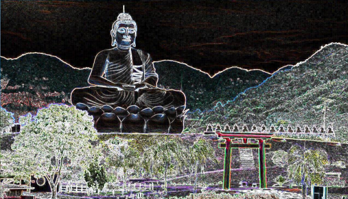

# Processador-de-Imagens-PNM
Programa em C++ que lê imagens no formato PNM em ASCII (P2 = tons de cinza,
P3 = colorida) e aplica filtros por meio de um menu no terminal.

## Filtros disponíveis
1. Escurecer
2. Clarear
3. Inverter cor (negativo)
4. Espelhar na horizontal
5. Espelhar na vertical
6. Desfocagem (média 3x3)
7. Sobel (detecção de bordas)
8. Converter para tons de cinza
9. Pixelizar (efeito retrô)
## Exemplos

| Original | Tons de cinza | Sobel |
|---|---|---|
|  |  |  |

## Como compilar e executar
g++ processador.cpp -o processador
./processadorr

Informe o nome do arquivo de entrada (.pnm), aplique quantos filtros
quiser e use a opção 0 para salvar o resultado.

## Observações
- Aceita imagens de até 2000x2000 pixels.
- Comentários (#) no cabeçalho do arquivo são ignorados.

## Autor
Caio Guilherme Gonzaga Silvestre
